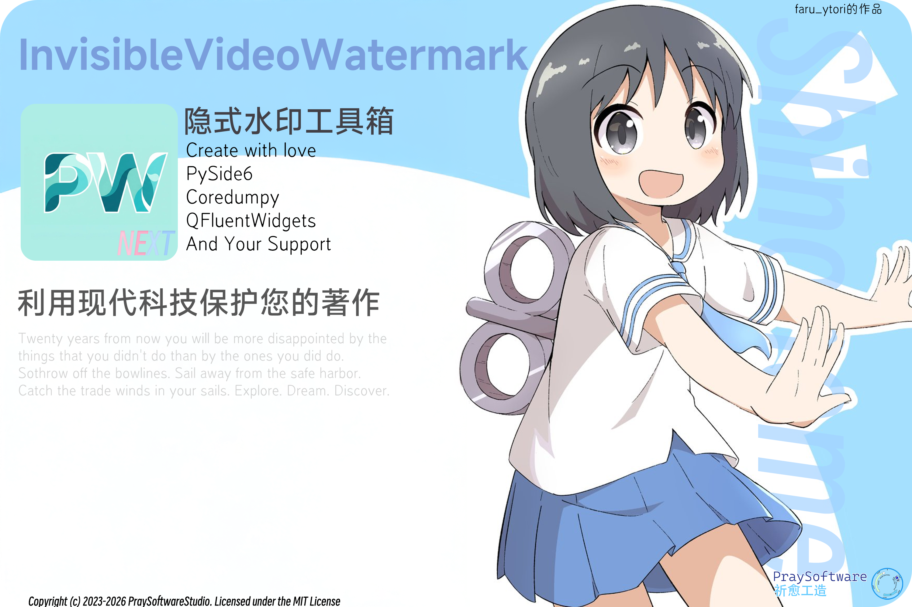

# InvisibleVideoWatermarkNEXT

[简体中文](README.md) | [繁體中文](readme/README_TW.md) | [English](README.en.md) | **日本語**



動画に目立たない透かしを埋め込み、抽出するための GUI アプリケーションです。Python、PySide6、FFmpeg と複数の透かしアルゴリズムを利用します。

## 主な機能

- テキスト透かし：Guofei、RivaGAN、周波数領域方式
- 画像透かし：FireKeeper と Guofei
- MP4、AVI、MOV、MKV などの入力形式
- ソフトウェアエンコードおよび環境に応じた NVIDIA / AMD ハードウェアアクセラレーション
- バッチ処理、フレームのサンプリング、プリセット、進捗表示
- PySide6 と Fluent Design を利用したデスクトップ画面

透かしの耐性は圧縮方式、画質、映像内容、設定によって異なります。すべての変換処理に対する保持を保証するものではありません。

## 動作環境

Python 3.10 以上、uv、FFmpeg が必要です。GPU 機能には対応ハードウェアやドライバーが必要になる場合があります。

## ソースコードから実行

```bash
git clone https://github.com/tucaodashen/invisible_video_watermark.git
cd invisible_video_watermark
uv sync
uv run MainEntrance.py
```

起動時に `assets` フォルダーとポート 1165・9999 の利用可否を確認します。FFmpeg の自動ダウンロードに失敗した場合は、手動でインストールして PATH に追加してください。

## 基本操作

1. 動画ファイルを追加します。
2. テキストまたは画像の透かし方式を選択します。
3. 透かしデータ、サンプリング、出力エンコードなどを設定します。
4. 処理を実行して結果を確認します。
5. 必要に応じて抽出機能で透かしを検証します。

フレームのサンプリングはランダム、全フレーム、均等、手動指定から選択できます。極端に低いビットレートを避け、リソースの競合を防ぐため複数インスタンスの同時実行は控えてください。

## Windows 向けビルド

`make/compile.bat` にビルド用スクリプトがあります。Nuitka、Windows 用ビルドツール、UPX、必要なアセットが関係する場合があります。詳細は [中国語 README のビルド手順](README.md#编译并发布) を参照してください。

## 開発状況

ドキュメント、多言語 UI、性能、ログ、メモリ使用量、知覚的サンプリングなどの改善が計画されています。これらは実装済みとは限りません。

## ライセンス

ソースコードは [MIT License](LICENSE) です。利用するライブラリや透かし方式のライセンスも確認してください。

[Issue を報告](https://github.com/tucaodashen/invisible_video_watermark/issues) · [メール](mailto:tucaodashenofficial@gmail.com)

PraySoftware 製作。
